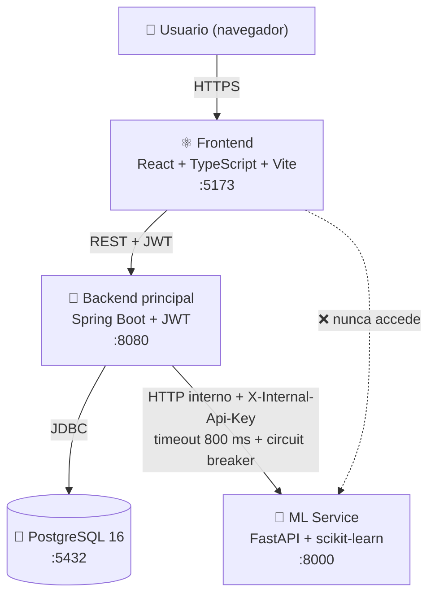
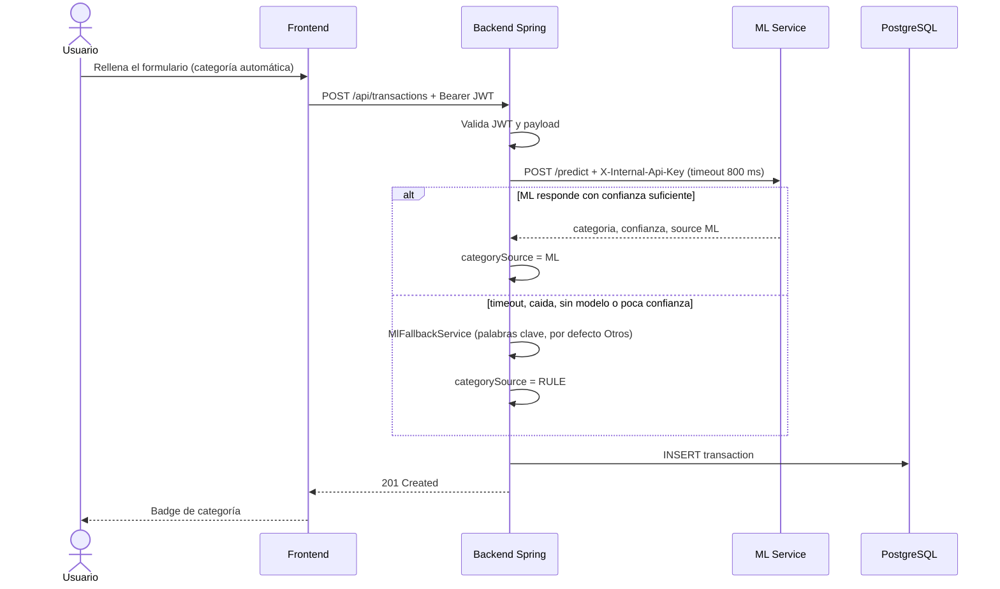

# 💰 Smart Finance Tracker

[](https://react.dev)
[](https://www.typescriptlang.org)
[](https://spring.io/projects/spring-boot)
[](https://fastapi.tiangolo.com)
[](https://www.postgresql.org)
[](https://docs.docker.com/compose/)
[](LICENSE)

Aplicación de gestión de finanzas personales con **categorización automática mediante Machine Learning**.
Monorepo con arquitectura de microservicios: escribes *"Cena en restaurante italiano"* y la transacción
se clasifica sola como **Restaurantes**; si el modelo falla, el sistema sigue funcionando con reglas.

> **Estado:** v0.1.0 (MVP). Tras clonar, valida tu entorno con [`scripts/smoke-test.sh`](scripts/smoke-test.sh)
> o sigue la [guía de pruebas](TESTING.md).

## 📑 Índice

[Arquitectura](#-arquitectura) · [Stack](#-stack-tecnológico) · [Requisitos](#-requisitos-previos) ·
[Quick start](#-instalación-y-ejecución-quick-start) · [Uso](#-uso-endpoints-principales) ·
[Estructura](#-estructura-del-proyecto) · [Testing](#-testing) · [Decisiones](#-decisiones-de-diseño) ·
[Roadmap](#-roadmap) · [Licencia](#-licencia)

## 🏗️ Arquitectura



**Flujo al crear una transacción sin categoría**



| Servicio | Rol |
|---|---|
| **Frontend** | SPA: login, transacciones, presupuestos y dashboard con gráficos. Guarda el JWT y lo envía en cada petición. |
| **Backend (Spring)** | Autenticación JWT, CRUD, reportes y lógica de negocio. Es el **único** que habla con el ML y quien decide el fallback. |
| **ML Service (FastAPI)** | Predice la categoría a partir de la descripción (TF-IDF + regresión logística). No conoce usuarios; solo acepta la API key interna. |
| **PostgreSQL** | Persistencia. El esquema lo versiona Flyway. |

## 🧰 Stack tecnológico

| Capa | Tecnologías |
|---|---|
| **Frontend** | React 18, TypeScript, Vite, React Router, TanStack Query, Axios, Recharts, CSS propio (sin framework) |
| **Backend** | Java 21, Spring Boot 3.3, Spring Security (JWT con jjwt), Spring Data JPA, Flyway, Resilience4j, WebClient, springdoc (Swagger) |
| **ML Service** | Python 3.12, FastAPI, scikit-learn (TF-IDF + LogisticRegression), pandas, joblib, Pydantic |
| **Base de datos** | PostgreSQL 16 |
| **Infra** | Docker Compose (healthchecks en los 4 servicios) |
| **Tests** | JUnit 5 + Mockito + WireMock · pytest |

## ✅ Requisitos previos

- **Docker** y **Docker Compose v2** (`docker compose`, no `docker-compose`)
- **Git**
- *Opcional* (solo para ejecutar sin Docker o lanzar los tests en local): Node.js 20+, JDK 21 + Maven 3.9+, Python 3.12+
- *Opcional*: `curl` y `jq` para las pruebas manuales y el script de humo

## 🚀 Instalación y ejecución (Quick start)

```bash
git clone https://github.com/EstherMaria2002/smart-finance-tracker.git
cd smart-finance-tracker

cp .env.example .env        # edita los valores (ver tabla)
docker compose up --build
```

> La primera construcción tarda unos minutos: Maven descarga dependencias y el ML service entrena el
> modelo inicial durante el build de su imagen.

| Variable | Descripción |
|---|---|
| `JWT_SECRET` | Clave de firma de los JWT (HS256). **Mínimo 32 caracteres**; si es más corta el backend no arranca. Genera una con `openssl rand -hex 32`. |
| `INTERNAL_API_KEY` | Clave compartida backend ↔ ML (cabecera `X-Internal-Api-Key`). Se pasa al backend como `ML_INTERNAL_API_KEY`. |
| `POSTGRES_DB` / `USER` / `PASSWORD` | Opcionales. Por defecto `sft` / `sft` / `sft`. |

Cuando `docker compose ps` muestre los cuatro servicios como `healthy`:

| Qué | URL |
|---|---|
| 🖥️ Frontend | http://localhost:5173 |
| 🔌 API del backend | http://localhost:8080 |
| 📘 Swagger del backend | http://localhost:8080/swagger-ui.html |
| 🩺 Health del backend | http://localhost:8080/actuator/health |
| 🤖 Swagger del ML (solo local) | http://localhost:8000/docs |

> 🔒 El puerto 8000 se publica únicamente en `127.0.0.1` para poder depurar. El ML **no** tiene CORS y el
> navegador nunca debe hablar con él.

Para parar todo: `docker compose down` (añade `-v` para borrar también la base de datos).

## 📡 Uso: endpoints principales

Todas las rutas `/api/**` exigen `Authorization: Bearer <JWT>`. Documentación interactiva en Swagger.

| Método | Ruta | Descripción | Auth |
|---|---|---|:-:|
| `POST` | `/auth/register` | Crear usuario (devuelve JWT) | ❌ |
| `POST` | `/auth/login` | Iniciar sesión (devuelve JWT) | ❌ |
| `GET` | `/api/transactions?from=&to=&categoryId=` | Listar transacciones | ✅ |
| `POST` | `/api/transactions` | Crear (categoriza con ML si `categoryId` es `null`) | ✅ |
| `PATCH` | `/api/transactions/{id}` | Editar / recategorizar manualmente | ✅ |
| `POST` | `/api/transactions/{id}/recategorize` | Volver a categorizar con ML | ✅ |
| `DELETE` | `/api/transactions/{id}` | Borrar | ✅ |
| `GET` | `/api/categories` | Listar (sistema + propias) | ✅ |
| `POST` | `/api/categories` | Crear categoría propia | ✅ |
| `GET` | `/api/budgets?month=YYYY-MM-DD` | Presupuestos del mes con gasto acumulado | ✅ |
| `PUT` | `/api/budgets` | Crear o actualizar (upsert) un límite mensual | ✅ |
| `DELETE` | `/api/budgets/{id}` | Borrar presupuesto | ✅ |
| `GET` | `/api/reports/monthly?year=` | Ingresos y gastos por mes | ✅ |
| `GET` | `/api/reports/by-category?from=&to=&type=` | Totales por categoría | ✅ |

**Ejemplo: registrarse y crear una transacción con categoría automática**

```bash
TOKEN=$(curl -s http://localhost:8080/auth/register \
  -H 'Content-Type: application/json' \
  -d '{"email":"yo@ejemplo.com","password":"password123","displayName":"Yo"}' | jq -r .token)

curl -s -X POST http://localhost:8080/api/transactions \
  -H "Authorization: Bearer $TOKEN" \
  -H 'Content-Type: application/json' \
  -d '{
        "amount": 42.50,
        "type": "EXPENSE",
        "description": "Cena en restaurante italiano",
        "occurredOn": "2026-09-20",
        "categoryId": null
      }' | jq
```

```json
{
  "id": 1,
  "amount": 42.50,
  "type": "EXPENSE",
  "description": "Cena en restaurante italiano",
  "occurredOn": "2026-09-20",
  "category": { "id": 1, "name": "Restaurantes", "color": "#FF6B6B", "icon": "🍽️", "system": true },
  "categorySource": "ML",
  "mlConfidence": 0.973,
  "createdAt": "2026-09-20T18:03:11.482Z"
}
```

`categorySource` indica quién decidió la categoría: `ML` (modelo), `RULE` (reglas del backend) o `MANUAL` (usuario).
El `mlConfidence` exacto puede variar.

## 🗂️ Estructura del proyecto

```text
smart-finance-tracker/
├── docker-compose.yml
├── .env.example
├── README.md · TESTING.md · GIT_GUIDE.md · LICENSE
├── scripts/smoke-test.sh            # prueba end-to-end por cURL
│
├── backend-java/                    # Spring Boot (paquete base com.sft)
│   ├── pom.xml · Dockerfile
│   ├── src/main/java/com/sft/
│   │   ├── config/                  # SecurityConfig (JWT, CORS), WebClientConfig, OpenApiConfig...
│   │   ├── auth/                    # AuthController/Service, JwtService, JwtAuthFilter
│   │   ├── user/ · category/ · budget/ · report/
│   │   ├── transaction/             # Entity, Repository, Service (lógica ML + fallback), Controller
│   │   ├── ml/                      # MlClient (WebClient), MlFallbackService
│   │   └── common/                  # GlobalExceptionHandler, excepciones, ApiError
│   ├── src/main/resources/db/migration/   # Flyway: V1__init_schema.sql, V2__seed_categories.sql
│   └── src/test/java/com/sft/       # TransactionServiceTest, MlClientTest (WireMock), MlFallbackServiceTest
│
├── ml-service-python/               # FastAPI
│   ├── requirements.txt · Dockerfile
│   ├── app/
│   │   ├── main.py · config.py
│   │   ├── api/                     # routes.py (/health, /predict, /retrain), deps.py (API key)
│   │   ├── schemas/                 # modelos Pydantic
│   │   ├── services/                # classifier.py, fallback_rules.py
│   │   ├── ml/                      # pipeline.py, train.py, model_store.py
│   │   └── data/seed_transactions.csv
│   ├── models/                      # category_model.joblib (se genera en el build)
│   └── tests/test_predict.py
│
└── frontend-react/                  # React + Vite
    ├── package.json · vite.config.ts · Dockerfile
    └── src/
        ├── api/ · auth/ · hooks/ · types/ · lib/
        ├── pages/                   # Login, Register, Dashboard, Transactions, Budgets
        └── components/              # layout/, transactions/, dashboard/, ui/
```

## 🧪 Testing

La guía completa, con resultados esperados paso a paso, está en **[TESTING.md](TESTING.md)**. Resumen:

```bash
# Prueba de humo end-to-end (requiere curl + jq y el stack levantado)
./scripts/smoke-test.sh
./scripts/smoke-test.sh --resilience     # además para el ML y comprueba el fallback

# Backend (JUnit + Mockito + WireMock)
cd backend-java && mvn test

# ML service (pytest)
cd ml-service-python && pip install -r requirements-dev.txt && pytest

# Frontend (comprobación de tipos y build)
cd frontend-react && npm install && npm run typecheck && npm run build
```

### 🛡️ Prueba de resiliencia: ¿qué pasa si el ML se cae?

```bash
docker compose stop ml-service        # simula la caída

curl -s -X POST http://localhost:8080/api/transactions \
  -H "Authorization: Bearer $TOKEN" -H 'Content-Type: application/json' \
  -d '{"amount":30,"type":"EXPENSE","description":"Taxi al aeropuerto","occurredOn":"2026-09-20","categoryId":null}' \
  | jq '{category: .category.name, categorySource, mlConfidence}'
# -> { "category": "Transporte", "categorySource": "RULE", "mlConfidence": null }   (HTTP 201)

docker compose start ml-service       # recupera el servicio
```

El backend **no devuelve 500**: captura el fallo, aplica reglas por palabra clave y marca la transacción como `RULE`.
Tras reiniciar el ML, el circuit breaker puede tardar hasta ~30 s en volver a usarlo (ver [TESTING.md](TESTING.md)).

## 🧭 Decisiones de diseño

- **Monorepo.** Un solo repositorio con una carpeta por servicio simplifica `docker compose`, las revisiones
  y los cambios que cruzan servicios (por ejemplo, el contrato `/predict`), sin coordinar versiones entre repos.
- **El ML service no autentica usuarios.** Solo valida una API key interna y nunca se expone al navegador:
  menos superficie de ataque y menos código. Más adelante puede migrarse a mTLS o a un service mesh.
- **El fallback vive en Spring, no en Python.** Si el ML cae, tarda más de 800 ms o no está seguro, el backend
  aplica reglas por palabra clave y devuelve igualmente `201`. La resiliencia es del sistema, no del servicio que falla.
  El ML solo garantiza responder siempre `200` con `{"category":"Otros","confidence":0.0,"source":"RULE"}` cuando no tiene modelo.
- **Flyway en lugar de `ddl-auto: update`.** Esquema versionado y reproducible; Hibernate solo **valida** (`ddl-auto: validate`).
- **`categorySource` + `mlConfidence` en cada transacción.** Trazabilidad de quién decidió la categoría (ML, usuario o regla):
  clave para depurar y para medir el modelo en el futuro.
- **La llamada al ML se hace fuera de la transacción de BD**, para no retener una conexión hasta 800 ms.
- **Importes siempre positivos**; el signo lo da `type` (`INCOME` / `EXPENSE`), con `CHECK (amount > 0)`.
- **Vite** en lugar de CRA, y **TanStack Query** en lugar de Redux: suficiente para el alcance actual.

## 🗺️ Roadmap

- [x] Monorepo con Docker Compose, Flyway, JWT, CRUD de transacciones, presupuestos y reportes
- [x] Integración Spring → ML con timeout, circuit breaker y fallback por reglas
- [x] Endpoint `/retrain` y script de entrenamiento (TF-IDF + regresión logística)
- [ ] **Entrenamiento real:** el dataset semilla (138 filas) da ~47 % de precisión en validación cruzada; el objetivo es > 70 % con datos reales (y persistir el modelo reentrenado en un volumen)
- [ ] **Tests de frontend** (Vitest + React Testing Library) y de integración con Testcontainers (migraciones Flyway)
- [ ] **CI/CD con GitHub Actions** (build + tests de los tres servicios) y despliegue en AWS / Render
- [ ] Paginación, refresh tokens y exportación de datos
- [ ] App móvil (React Native)

## 📄 Licencia

Distribuido bajo licencia **MIT**. Consulta el fichero [LICENSE](LICENSE).

## 👤 Autor

**Esther** · [GitHub](https://github.com/EstherMaria2002) · [LinkedIn](https://www.linkedin.com/in/esther-mar%C3%ADa-cant%C3%B3n-s%C3%A1nchez-511725275/)
